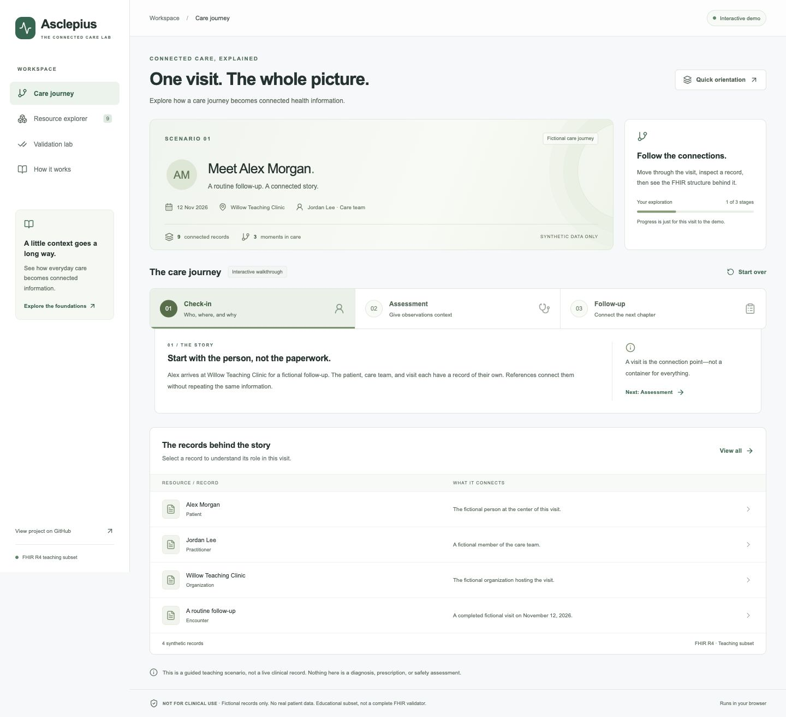
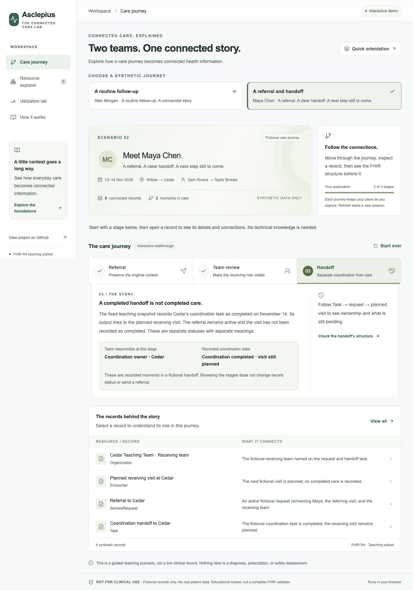

# Asclepius — Connected care, explained

[](https://github.com/SafetyMP/Asclepius/actions/workflows/ci.yml)
[](https://github.com/SafetyMP/Asclepius/actions/workflows/codeql.yml)
[](LICENSE)

Explore how a fictional visit or referral becomes connected health records. Asclepius gives
healthcare stakeholders a guided view of two synthetic cases, their context, and the
FHIR (Fast Healthcare Interoperability Resources) records behind each story. Developers can look deeper in the validation lab and
ports-and-adapters teaching kit.

**[Explore the live demo](https://safetymp.github.io/Asclepius/)** ·
[Read both journeys](docs/JOURNEYS.md) · [Project vision](docs/PROJECT.md) ·
[Documentation map](docs/README.md)

The demo runs in the browser, with no account, API server, or token required.

> **NOT_FOR_CLINICAL_USE — NOT FOR CLINICAL USE.** Synthetic examples only.
> Do not store, process, or base clinical decisions on real patient data.
> Asclepius is an educational reference, not a clinical data platform or a
> production FHIR server. Its drug-interaction knowledge base is intentionally
> incomplete. Never connect it to real clinical systems, pharmacies, or EHRs.



## Start with your question

| Your goal | Start here |
| --- | --- |
| Understand how a visit becomes connected records | [Live care journeys](https://safetymp.github.io/Asclepius/) or the [written walkthrough](docs/JOURNEYS.md) |
| Follow a referral between care teams | [Maya’s handoff guide](docs/JOURNEYS.md#maya-a-referral-and-handoff) |
| Explore the code or contribute | [Local setup](#run-the-browser-demo-locally), [contributing](CONTRIBUTING.md), and [architecture decisions](docs/adr/README.md) |
| Navigate the repository with a coding agent | [Repository instructions](AGENTS.md) and [source map](docs/README.md#source-map) |

## Explore the story, then the structure

- **Care journeys:** follow Alex’s routine visit or Maya’s referral from Willow
  to Cedar. Inspect the records that give each step its context.
- **Resource explorer:** read key facts, follow incoming and outgoing
  connections, and retrace your steps through nine fictional records in each journey.
  “View all” clears prior filters; sidebar navigation resumes the saved search.
- **Validation lab:** check a sample and repair a missing identity without
  coding. JSON editing is available under advanced details. Checks run locally
  in the browser and do not change the fictional case.
- **How it works:** start with stakeholder questions and a plain-language
  glossary; expand developer architecture and source links when needed.

Each journey keeps its own progress, open record, and explorer search while
navigating within the demo. Refresh starts a new session; practice drafts are
discarded when leaving the lab.

The interface is designed around a calm workspace and a contextual first
interaction. It replaces the former clinical-console tool grid and setup-first
experience. The intended improvements are easier orientation and a clearer
connection between a case and its data; these are design hypotheses, not
measured claims of better engagement. See [the design rationale](docs/DESIGN-PIVOT.md).

### Referral and handoff

Choose **A referral and handoff** for Maya Chen’s fictional Willow → Cedar journey.
The referral remains active, Cedar’s coordination task is completed, and the
receiving visit is planned. Stage navigation explores a fixed teaching snapshot;
it does not change statuses or send a referral. Full record identities keep the
two practitioners, organizations, and visits distinct. The final stage opens the
handoff record, with prominent links to the request and planned receiving visit.



### What validation means here

The lab uses the repository’s eleven hand-authored FHIR R4 Zod schemas and three
teaching profile rules. Passing means **passes this teaching subset**. It does
not establish full FHIR conformance, terminology validity, reference existence,
clinical correctness, or the safety of a treatment. The resource types are
Patient, Practitioner, Organization, Encounter, Condition, Observation,
MedicationRequest, AllergyIntolerance, DiagnosticReport, ServiceRequest, and Task.
The referral subset checks request and coordination structure. Task input/output
values support references or strings only. It does not verify receipt by a team,
clinical appropriateness, or completion of care.

## Run the browser demo locally

Use **Node.js 22**, **npm 10.9.2**, and **Python 3** for the web workflow. The root
package also supports newer Node versions; the web package currently specifies
Node 22. Installing the root dependencies builds `better-sqlite3` and may require
a C++ toolchain.

```bash
npm ci
cd web
npm ci
npm run build
npm run start
```

Open [the local demo](http://127.0.0.1:3200). `npm run start` serves the static
`web/out/` export using Python; it does not start a Next.js server or a FHIR API.
For UI development, use `cd web && npm run dev` after installation.

See [web/README.md](web/README.md) for routes, GitHub Pages configuration, and
verification commands. The public experience is a working educational demo; the
local teaching API is a separate development reference. See [project scope and
priorities](docs/PROJECT.md) before proposing an extension.

## The local teaching kit

The backend remains a separate local reference implementation. Its existing
TypeScript, Zod, Hono, and storage architecture is retained. The static website
does not call the local API, issue credentials, or operate its clinical-rule
endpoints. The former patient route opens the synthetic journey; the former
authentication, CDS, and interaction routes explain the local examples and link
to code instead of presenting unavailable API controls.

| Component | Teaching implementation |
| --- | --- |
| Resource model | Eleven Zod schemas, inferred TypeScript types, datatypes, Bundle, and OperationOutcome |
| Validation | Structural checks and three profile rules; local `$validate` operation |
| Storage | Repository port with versioned in-memory and SQLite adapters |
| Search | Query-plan parser/compiler and executor with a supported subset of FHIR search |
| HTTP | Hono routes for resource operations, history, search, and validation |
| Rule examples | Composable CDS rules and an intentionally incomplete six-interaction DDI knowledge base |
| Authentication | JWT verification and SMART-style scopes; development-only token issuer |
| Audit | Hash-chained append-only log with in-memory and SQLite adapters |

From the repository root:

```bash
npm run dev       # local teaching API at http://127.0.0.1:8787
npm test          # unit and integration tests
npm run gate      # format, lint, typecheck, test, build
```

`src/app.ts` is the local harness’s composition root. Dependencies point inward:
adapters use ports and domain types; services use ports and domain types; domain
code does not import adapters. Zod is the source of truth for the supported FHIR
types. See the [architecture decisions](docs/adr/) and [contributor guide](CONTRIBUTING.md).

This kit does not replace a production FHIR server. The ADRs explain the
tradeoffs and identify production-oriented alternatives for capabilities this
teaching implementation does not provide.

## Verification and deployment

A change requires the root `npm run gate`. The web checks cover the exported
experience, including its main interactions, responsive navigation,
accessibility, and the GitHub Pages subpath. Run `cd web && npm run verify` for
the web gate; see the web guide for the full browser suite.

The [Pages workflow](.github/workflows/pages.yml) builds and checks the site on
pull requests, then deploys verified `main` builds with the `/Asclepius` base
path. Deployment status is available in the repository’s Actions tab.

Old console captures are retained as historical assets, not screenshots of the
current interface. See [the asset inventory](docs/assets/README.md).

## Regulatory disclaimer

Asclepius is an educational reference. It is **not** a certified medical device,
**not** HIPAA- or HITRUST-compliant, and carries no warranty of fitness for any
clinical purpose. The DDI knowledge base is intentionally incomplete; missing
interaction data is a patient-safety hazard. Do not use this software to store
real patient data or make clinical decisions.

## Contributing and license

Read [CONTRIBUTING.md](CONTRIBUTING.md), [AGENTS.md](AGENTS.md), and
[SECURITY.md](SECURITY.md). Do not report vulnerabilities in public issues.
[docs/README.md](docs/README.md) maps the remaining documentation.

Licensed under the [Apache License, Version 2.0](LICENSE). See
[NOTICE.md](NOTICE.md). Provided on an “AS IS” basis, without warranties or
conditions of any kind.
