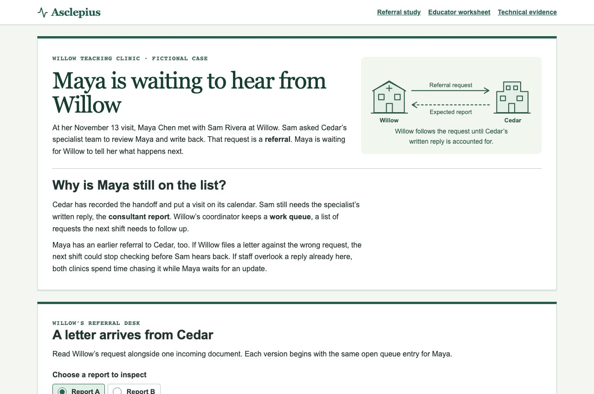

# Asclepius — Connected care, explained

[](https://github.com/SafetyMP/Asclepius/actions/workflows/ci.yml)
[](https://github.com/SafetyMP/Asclepius/actions/workflows/codeql.yml)
[](LICENSE)

Maya is waiting to hear back after Willow asked Cedar for a specialist review. As Willow’s coordinator, read the request beside an incoming letter and decide what the next shift should see. [Open the Willow–Cedar case](https://safetymp.github.io/Asclepius/)



## Work through the case

1. Compare the open request with one of two letters about Maya. Try marking a report received or keeping it on the work queue. Read the evidence and the next owner, then try the other letter against the same request.
2. In the optional educator worksheet, compare a mentor walkthrough, a one-page guide and interactive practice. Vary the learner count and staff time, then decide how to test accuracy on an unseen referral a week later.
3. Open [technical evidence](https://safetymp.github.io/Asclepius/workspace/) to trace the selected letter, receipt rule and simulated queue entry. Compare filing the same letter against two registers, then run the shared validator on an intact fixture and a copy with its required status removed.

The [fixture guide](docs/JOURNEYS.md) documents the authored records. The [web guide](web/README.md) covers local setup, routes and tests. The public exercise needs no account, API server or token.

> **NOT_FOR_CLINICAL_USE — NOT FOR CLINICAL USE.** Synthetic examples only. Never use real patient data. The educational subset does not establish full FHIR conformance, clinical correctness, treatment safety, or specialist report delivery in a real clinic. The local drug-interaction knowledge base is intentionally incomplete.

## Run the browser demo locally

Use **Node.js 22**, **npm 10.9.2**, and **Python 3** for the web workflow. The root
package also supports newer Node versions; the web package currently specifies
Node 22. Installing the root dependencies builds `better-sqlite3` and may require
a C++ toolchain.

```bash
npm ci
cd web
npm ci
npm run build
npm run start
```

Open [the local demo](http://127.0.0.1:3200). `npm run start` serves the static
`web/out/` export using Python; it does not start a Next.js server or a FHIR API.
For UI development, use `cd web && npm run dev` after installation.

See [web/README.md](web/README.md) for routes, GitHub Pages configuration, and
verification commands. The public experience is a working educational demo; the
local teaching API is a separate development reference. See [project scope and
priorities](docs/PROJECT.md) before proposing an extension.

## The local teaching kit

The backend remains a separate local reference implementation. Its existing
TypeScript, Zod, Hono, and storage architecture is retained. The static website
does not call the local API, issue credentials, or operate its clinical-rule
endpoints. The former patient route opens the synthetic journey; the former
authentication, CDS, and interaction routes explain the local examples and link
to code instead of presenting unavailable API controls.

| Component | Teaching implementation |
| --- | --- |
| Resource model | Eleven Zod schemas, inferred TypeScript types, datatypes, Bundle, and OperationOutcome |
| Validation | Structural checks and three profile rules; local `$validate` operation |
| Storage | Repository port with versioned in-memory and SQLite adapters |
| Search | Query-plan parser/compiler and executor with a supported subset of FHIR search |
| HTTP | Hono routes for resource operations, history, search, and validation |
| Rule examples | Composable CDS rules and an intentionally incomplete six-interaction DDI knowledge base |
| Authentication | JWT verification and SMART-style scopes; development-only token issuer |
| Audit | Hash-chained append-only log with in-memory and SQLite adapters |

From the repository root:

```bash
npm run dev       # local teaching API at http://127.0.0.1:8787
npm test          # unit and integration tests
npm run gate      # format, lint, typecheck, test, build
```

`src/app.ts` is the local harness’s composition root. Dependencies point inward:
adapters use ports and domain types; services use ports and domain types; domain
code does not import adapters. Zod is the source of truth for the supported FHIR
types. See the [architecture decisions](docs/adr/) and [contributor guide](CONTRIBUTING.md).

This kit does not replace a production FHIR server. The ADRs explain the
tradeoffs and identify production-oriented alternatives for capabilities this
teaching implementation does not provide.

## Verification and deployment

A change requires the root `npm run gate`. The web checks cover the exported
experience, including its main interactions, responsive navigation,
accessibility, and the GitHub Pages subpath. Run `cd web && npm run verify` for
the web gate; see the web guide for the full browser suite.

The [Pages workflow](.github/workflows/pages.yml) builds and checks the site on
pull requests, then deploys verified `main` builds with the `/Asclepius` base
path. Deployment status is available in the repository’s Actions tab.

Old console captures are retained as historical assets, not screenshots of the
current interface. See [the asset inventory](docs/assets/README.md).

## Regulatory disclaimer

Asclepius is an educational reference. It is **not** a certified medical device,
**not** HIPAA- or HITRUST-compliant, and carries no warranty of fitness for any
clinical purpose. The DDI knowledge base is intentionally incomplete; missing
interaction data is a patient-safety hazard. Do not use this software to store
real patient data or make clinical decisions.

## Contributing and license

Read [CONTRIBUTING.md](CONTRIBUTING.md), [AGENTS.md](AGENTS.md), and
[SECURITY.md](SECURITY.md). Do not report vulnerabilities in public issues.
[docs/README.md](docs/README.md) maps the remaining documentation.

Licensed under the [Apache License, Version 2.0](LICENSE). See
[NOTICE.md](NOTICE.md). Provided on an “AS IS” basis, without warranties or
conditions of any kind.
